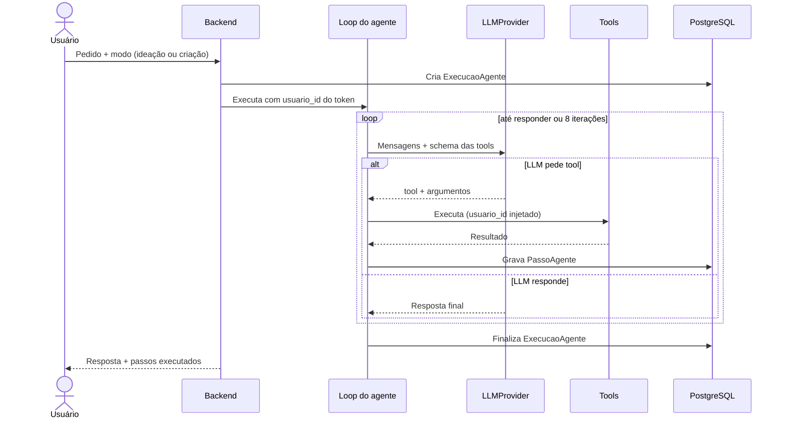
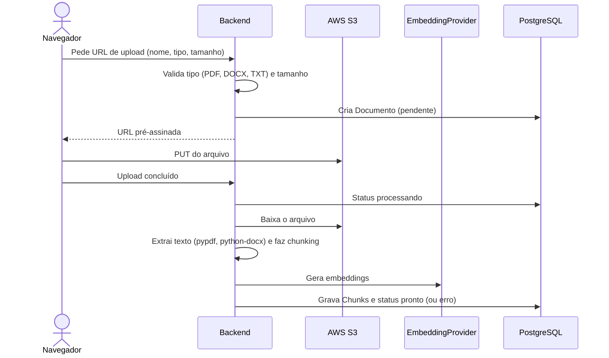

# Agente e RAG

> Status: **planejado**.

## Loop do agente

Implementado manualmente sobre o tool calling do SDK do provedor, **sem LangChain nem LlamaIndex** (ver [decisões](decisoes.md)).

- **Máximo de 8 iterações.** Ao atingir o limite, a execução termina e o usuário é avisado.
- **Prompts de sistema** separados por modo em `app/ai/agent/prompts/`.
- **Segurança:** o `usuario_id` é injetado pelo backend em toda tool. Ele não aparece no schema que o LLM vê.
- **Rastreabilidade:** cada passo (tool, argumentos, duração, erro) vira log estruturado e registro em `PassoAgente`.

## Modos

| Modo | Objetivo | Tools mais usadas |
| --- | --- | --- |
| Ideação | Sugerir temas | `pesquisar_web`, `buscar_posts_anteriores`, `analisar_desempenho`, `listar_assuntos` |
| Criação | Escrever o post completo | `obter_assunto`, `buscar_documentos`, `buscar_posts_anteriores`, `adaptar_para_rede`, `gerar_imagem`, `salvar_rascunho` |

## Tools

Uma por arquivo em `app/ai/tools/`, com schema de entrada em Pydantic.

| Tool | O que faz |
| --- | --- |
| `pesquisar_web(query)` | Busca no Tavily ou Brave, sempre retornando as fontes |
| `listar_assuntos()` | Lista os assuntos do usuário |
| `obter_assunto(id)` | Detalhes do assunto (público-alvo, tom de voz) |
| `buscar_documentos(query)` | RAG híbrido nos documentos do usuário |
| `buscar_posts_anteriores(assunto)` | Exemplos de estilo, só de posts aprovados ou publicados |
| `analisar_desempenho()` | Agregados por assunto, dia, horário, rede e imagem. Com menos de 5 posts no grupo, informa que os dados são insuficientes |
| `adaptar_para_rede(texto, rede)` | Ajusta formato e limite de caracteres da rede |
| `gerar_imagem(prompt, formato)` | Gera imagem sem texto dentro dela e salva no S3 |
| `salvar_rascunho(post)` | Salva o post com status `rascunho` (único status que o agente pode usar) |

## Provedores

O agente depende apenas das interfaces abaixo. As implementações ficam em `app/ai/providers/`.

| Interface | Responsabilidade |
| --- | --- |
| `LLMProvider` | Chat com tool calling (provedor **a definir**) |
| `EmbeddingProvider` | Vetores para chunks e consultas |
| `ImageProvider` | Geração de imagem |
| `VectorStore` | Busca híbrida (implementação: `PgVectorStore`) |

## Pipeline de documentos (RAG)

## Busca híbrida

`buscar_documentos` combina:

1. **Similaridade vetorial** (pgvector, índice HNSW) sobre o embedding da consulta.
2. **Full-text** (`tsvector` em português) sobre o conteúdo.

Os dois rankings são combinados em uma lista única, por exemplo com Reciprocal Rank Fusion. A consulta **sempre** filtra por `usuario_id`.

## Testes

LLM, embeddings, imagem e busca web são **sempre mockados**, com respostas gravadas e determinísticas. Nenhum teste chama API paga ou depende de rede externa.
