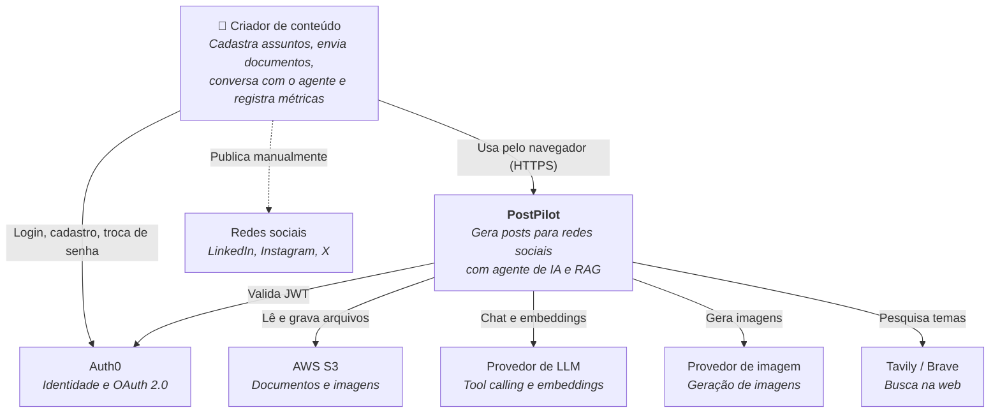
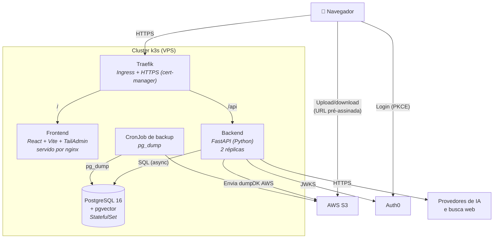
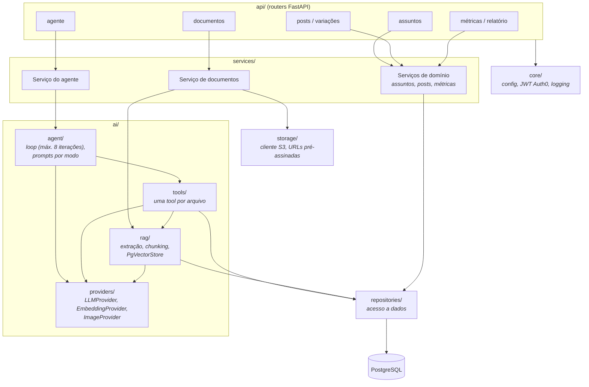

# Arquitetura (modelo C4)

> Status: **planejada**. Atualize os diagramas conforme a implementação evoluir.

## Nível 1: Contexto

Quem usa o sistema e com quais sistemas externos ele conversa.



A publicação nas redes é feita pelo próprio usuário. A integração automática está fora do escopo (roadmap).

## Nível 2: Contêineres



Pontos importantes:

- O frontend obtém o token no Auth0 e o envia como `Authorization: Bearer` em cada chamada à API.
- Os arquivos vão **direto do navegador para o S3**, com URL pré-assinada gerada pelo backend. O backend nunca recebe o upload.
- No banco fica só a **chave** do objeto S3, nunca a URL.

## Nível 3: Componentes do backend



Regras de dependência:

- Routers são finos e só chamam services.
- O código do agente depende **apenas das interfaces** em `ai/providers/`, nunca de um SDK diretamente.
- O `usuario_id` vem do token validado em `core/` e é repassado a services, repositories e tools. O LLM nunca escolhe de qual usuário ler dados.

## Componentes do frontend

```
src/
├── pages/        # uma página por rota (React Router)
├── components/   # layout e componentes do TailAdmin
├── features/     # assuntos, posts, documentos, agente, relatorio
│   └── */api.ts  # hooks TanStack Query (única forma de chamar a API)
└── lib/          # cliente HTTP, integração com Auth0
```
