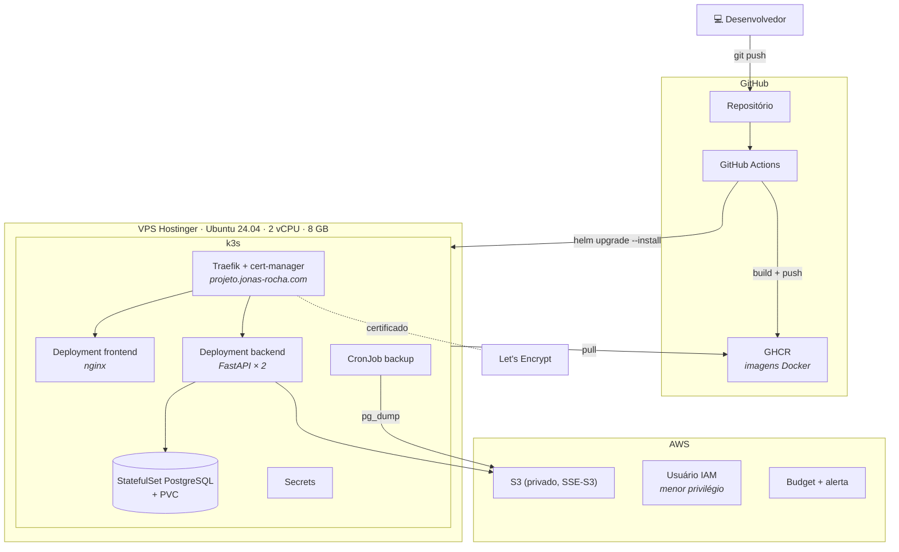
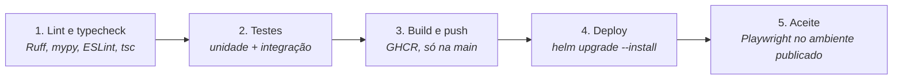

# Implantação, CI/CD e IaC

> Status: **planejada**. Não altere recursos em produção sem revisar antes o `terraform plan` ou o `helm template`.

## Modelo de implantação

Todo Deployment define `requests` e `limits` de CPU e memória.

## Pipeline (GitHub Actions)

## Artefatos de IaC

| Ferramenta | Pasta | Responsabilidade |
| --- | --- | --- |
| Terraform | `infra/terraform/` | Bucket S3 (Block Public Access, SSE-S3, CORS só para o domínio de produção e `localhost`, lifecycle de uploads incompletos), usuário IAM (`GetObject`, `PutObject`, `DeleteObject` neste bucket), AWS Budget, estado remoto |
| Ansible | `infra/ansible/` | Provisionamento da VPS: usuários, firewall, instalação do k3s |
| Helm | `infra/helm/postpilot/` | Chart da aplicação: Deployments, StatefulSet, Ingress, CronJob, Secrets |

## Configuração e segredos

- Configuração só por variáveis de ambiente (pydantic-settings). O `.env.example` lista todas.
- Em produção, os segredos ficam em Secrets do Kubernetes. No pipeline, em GitHub Secrets.
- Nunca commitar `.env`, chaves ou kubeconfig.

## Logs

JSON no stdout (structlog), com `request_id` e `usuario_id` quando houver. Sem arquivos de log. Tokens, chaves e conteúdo completo de documentos nunca são registrados.

## Backup

CronJob com `pg_dump` enviando o dump para o S3.
