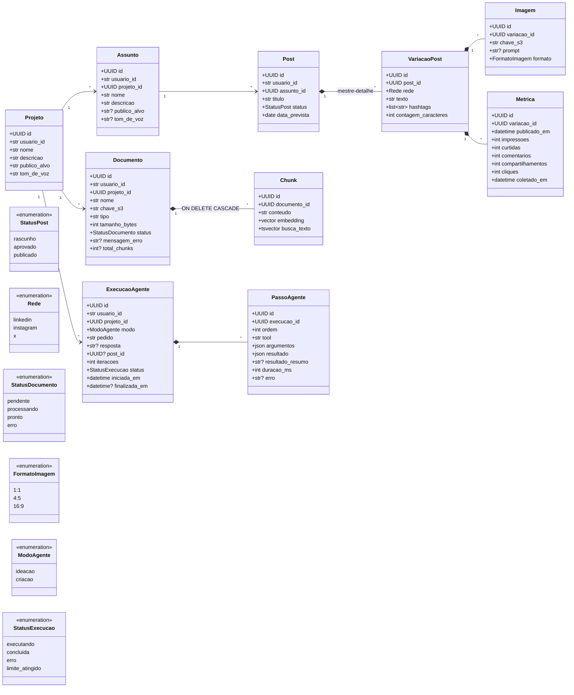

# Modelo de dados

> Status: **planejado**. Toda mudança de modelo vem com migration Alembic revisada à mão. Atualize este diagrama junto.

Todas as entidades do usuário têm `usuario_id` (o `sub` do Auth0), `criado_em` e `atualizado_em`. Todas as consultas filtram por `usuario_id`.

O **Projeto** (a marca do próprio usuário ou um cliente) é o topo da hierarquia: assuntos, documentos e execuções do agente pertencem a um projeto, e os posts pertencem a ele através do assunto. Assim, o conteúdo e os documentos de um cliente nunca se misturam com os de outro.

## Diagrama de classes

## Regras

| Entidade | Regra |
| --- | --- |
| Projeto | CRUD completo. Define o público-alvo e o tom de voz padrão. Só pode ser excluído quando não tem assuntos nem documentos (a API responde `409` caso contrário), para evitar apagar conteúdo e arquivos no S3 por engano. |
| Assunto | CRUD completo (requisito do TCC). Pertence a um projeto. `publico_alvo` e `tom_de_voz` são opcionais: quando vazios, valem os do projeto. Só pode ser excluído sem posts (`409` caso contrário). |
| Post | CRUD completo. O agente só cria com status `rascunho`; aprovar e publicar é ação do usuário. Não tem `projeto_id`: o projeto vem do assunto (`post → assunto → projeto`), evitando dados duplicados que podem ficar inconsistentes. |
| VariacaoPost | Editada na mesma tela do Post (mestre-detalhe, requisito do TCC). No máximo uma variação por rede em cada post, e pelo menos uma. Ao salvar o post, a variação de uma rede que continua mantém o `id` (as imagens e métricas ficam ligadas a ele). `contagem_caracteres` conta texto + hashtags e não pode passar do limite da rede (LinkedIn 3000, Instagram 2200, X 280). |
| Imagem | Guarda só a chave S3 (ex.: `usuarios/{id}/projetos/{id}/posts/{id}/{uuid}.png`), nunca a URL. `prompt` preenchido quando gerada pelo agente, `null` quando enviada pelo usuário. PNG, JPEG ou WebP até 5 MB; no máximo 10 por variação. Apagada (com o objeto no S3) junto com a variação. |
| Metrica | Uma coleta registrada manualmente pelo usuário, só com o post `publicado`. Os números são totais acumulados no momento da coleta; a mais recente é a que vale. `coletado_em` não pode ser antes de `publicado_em` nem no futuro. Taxa de engajamento = (curtidas + comentários + compartilhamentos + cliques) ÷ impressões. Apagada junto com a variação. |
| Documento | Pertence a um projeto e só é usado pelo RAG desse projeto. O status acompanha o processamento: `pendente` → `processando` → `pronto` ou `erro`. Chave S3: `usuarios/{id}/projetos/{id}/documentos/{uuid}.{ext}`. |
| Chunk | Apagado em cascata com o Documento. A dimensão do `embedding` vem da configuração; trocar o modelo de embeddings exige reprocessar tudo. Índices: HNSW no `embedding` e GIN no `tsvector`. |
| ExecucaoAgente | Criada como `executando` e atualizada pelo loop em segundo plano. `post_id` aponta para o rascunho salvo pelo agente (modo criação). |
| PassoAgente | Um registro por tool chamada, gravado assim que a tool termina (é o que a tela mostra ao vivo). `resultado` guarda a saída completa; `resultado_resumo` é o texto curto exibido. |
