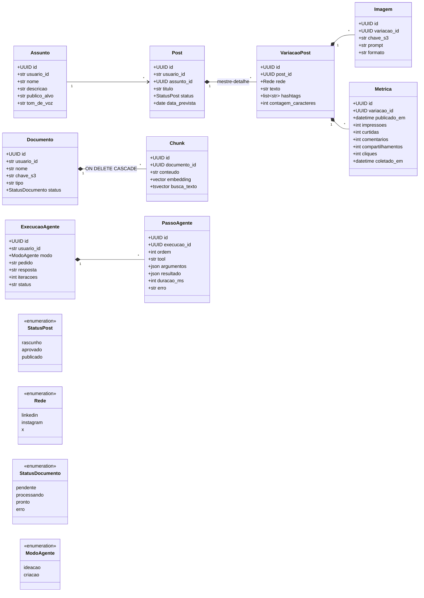

# Modelo de dados

> Status: **planejado**. Toda mudança de modelo vem com migration Alembic revisada à mão. Atualize este diagrama junto.

Todas as entidades do usuário têm `usuario_id` (o `sub` do Auth0), `criado_em` e `atualizado_em`. Todas as consultas filtram por `usuario_id`.

## Diagrama de classes

## Regras

| Entidade | Regra |
| --- | --- |
| Assunto | CRUD completo (requisito do TCC). |
| Post | CRUD completo. O agente só cria com status `rascunho`; aprovar e publicar é ação do usuário. |
| VariacaoPost | Editada na mesma tela do Post (mestre-detalhe, requisito do TCC). No máximo uma variação por rede em cada post. |
| Imagem | Guarda só a chave S3 (ex.: `usuarios/{id}/posts/{id}/{uuid}.png`), nunca a URL. |
| Metrica | Registrada manualmente pelo usuário depois de publicar. |
| Documento | O status acompanha o processamento: `pendente` → `processando` → `pronto` ou `erro`. |
| Chunk | Apagado em cascata com o Documento. A dimensão do `embedding` vem da configuração; trocar o modelo de embeddings exige reprocessar tudo. Índices: HNSW no `embedding` e GIN no `tsvector`. |
| PassoAgente | Um registro por tool chamada, exibido na tela da execução. |
